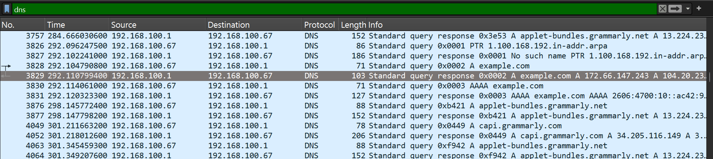

# Day 5 — DNS and HTTP Traffic Analysis

## 1. DNS Journey

1. The user enters a website name, such as `example.com`, in the browser.
2. The browser checks its DNS cache for the website's IP address.
3. If the IP address is not found, a request is sent to a Recursive DNS Resolver.
4. The resolver finds the IP address by contacting Root, TLD and Authoritative DNS servers.
5. The IP address is returned to the browser, which connects to the web server and loads the website.

## 2. DNS Analysis

- **Domain:** example.com
- **DNS Query Packet:** 3828
- **DNS Response Packet:** 3829
- **DNS Server:** 192.168.100.1

**Returned IPv4 Addresses:**
1. 172.66.147.243
2. 104.20.23.154

The DNS query asks for the IP address of example.com. The DNS server responds with two IPv4 addresses.

## 3. HTTP Basics

HTTP uses the Hypertext Transfer Protocol.

- **GET:** Used to request a resource from a server.
- **Host:** Identifies the website requested by the browser.

**Captured Host:** brightgrandfreshsunset.neverssl.com

## 4. DNS Record Types

**A Record:** It maps a domain name to an IPv4 address.

**MX Record:** It tells which mail server receives emails for a domain. A Null MX means the domain does not accept email.

**NS Record:** It identifies the authoritative name servers for a domain.

## 5. Traffic Detective

**1. HTTP Traffic Capture:**

I used tcpdump to capture HTTP traffic. I could see the GET request and the server response in readable text.

**2. Source Port:**

My source port was **58260**.

**3. TCP Three-Way Handshake:**

- `[S]` — SYN: Client starts the connection.
- `[S.]` — SYN-ACK: Server responds.
- `[.]` — ACK: Client confirms the connection.

**4. Why is HTTP text not visible in HTTPS?**

HTTPS uses TLS encryption to protect HTTP data. Therefore, the actual HTTP content is not normally visible as readable text in packet captures.

## 6. Wireshark DNS Screenshot

